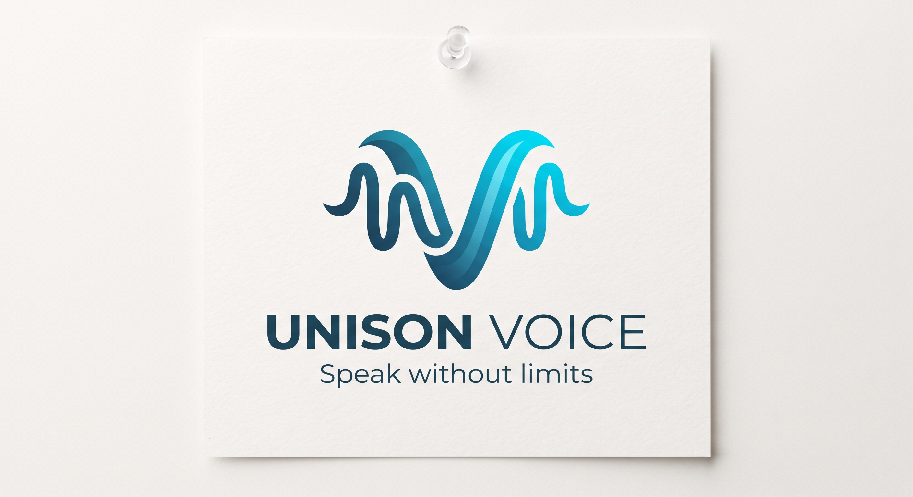

# Unison Voice

> **Speak without limits.**

Copyright (c) 2026 Unison Voice contributors. Licensed under the [MIT
License](LICENSE).

Unison Voice is an assistive AI concept for people whose speech is difficult
for others to understand. It learns an individual's unique way of speaking
and helps turn their utterances into clear text and/or natural synthesized
speech, while keeping the person in control of what is communicated.



## Current status: research phase

We are **currently in the research phase**. We are not presenting a finished
medical product or a validated speech model. Our immediate priorities are:

- finding suitable, representative, and legally usable speech datasets;
- understanding the lived experience and communication needs of people with
  speech disabilities;
- reaching out to speech and language therapists, self-help groups,
  inclusion organizations, and potential pilot partners;
- validating the technical, social, ethical, and regulatory assumptions before
  building a prototype.

The project is being shaped with affected people, rather than designing for
them without their input. Research participation, consent, accessibility, and
participant safety come before model performance.

## The challenge

People with speech disabilities are often not understood in everyday life,
especially by people who do not know them. Uncertainty and fear of
misunderstandings can cause people to avoid conversations with strangers,
which may contribute to social isolation.

The challenge is to design a personalized AI assistant trained on an
individual's speech that translates their utterances into a form others can
understand. Students and collaborators will explore the technical, social,
ethical, and legal aspects of such a solution.

The intended outcome is a concept or prototype of a personalized AI assistant
for speech translation that supports greater participation and
self-determination.

## Vision and goals

- Make everyday communication more accessible without replacing the user's
  voice, agency, or decisions.
- Develop personalized support rather than assuming that one model works for
  every speaker or condition.
- Understand the needs and perspectives of people with speech disabilities
  through responsible co-design.
- Provide understandable text and/or speech with a confirmation step when the
  system is uncertain.
- Demonstrate measurable progress against a transparent baseline.

The relevant Sustainable Development Goals are **SDG 3 (Good Health and
Well-being)** and **SDG 10 (Reduced Inequalities)**.

## Who we want to collaborate with

The project depends on collaboration with:

- people with speech disabilities and their families or support networks;
- speech-language pathologists and other clinical professionals;
- self-help groups and organizations working in inclusion and accessibility;
- researchers and institutions with relevant datasets or ethics expertise;
- technology and AI experts who can help evaluate safe, maintainable
  solutions.

We are actively reaching out to organizations and professionals who work with
these communities. The challenge contact listed in the source brief is
**Dr. Marcella Rosenberger**.

## Proposed product concept

Unison Voice should offer one simple interface with two processing modes:

1. **Online mode:** a consent-based cloud pipeline for higher-capacity
   automatic speech recognition (ASR), normalization, and text-to-speech (TTS).
2. **Offline mode:** an on-device fallback for privacy, resilience, and
   situations without a reliable connection.

The user remains in control. The assistant must not confidently speak an
incorrect sentence on the user's behalf. The pilot default is therefore:

- show the raw transcript, normalized suggestion, and alternatives;
- ask for confirmation before speaking when confidence is low (and initially
  consider confirmation for every utterance);
- allow correction, phrasebook entries, text entry, and symbol-based fallback;
- never invent facts, add meaning, or silently change the user's intent.

### Research architecture

The current technical direction is intentionally provisional:

| Layer | Research direction |
| --- | --- |
| Client | Flutter mobile app with capture, voice activity detection, UI, and playback |
| Service boundary | Abstract `SpeechTranslationService` so online and offline engines can be compared |
| Cloud ASR | faster-whisper, beginning with a German-capable configuration |
| Offline ASR | whisper.cpp, initially with a base or small model |
| Normalization | Phrasebook and constrained candidates first; an LLM only when evaluation justifies it |
| TTS | German-capable Piper voice as the current candidate, subject to licence and quality review |
| Profile store | Local SQLite; server storage only with explicit consent |

### Assumed end-to-end workflow

The following describes the workflow we currently assume for a single
utterance. It is a design hypothesis to validate with participants, not a
promise that every step or technology has been finalized.

1. **Prepare the profile.** With explicit consent, the user completes short,
   low-fatigue enrolment sessions. The app stores approved vocabulary,
   preferred phrases, correction pairs, language, endpointing preferences,
   and voice-output settings. The user can review or delete this information.
2. **Capture speech.** The mobile app records 16 kHz mono audio, keeps a small
   in-memory pre-roll so initial sounds are not clipped, and uses voice
   activity detection (VAD) to find the start and end of an utterance.
   Longer pauses must be configurable because they can be part of a person's
   natural speech.
3. **Choose a processing path.** A router checks the user's privacy setting,
   connectivity, measured latency, and device capability. It sends the
   utterance to the consented cloud path when appropriate, or keeps it on the
   device in offline-only mode. If the connection fails, the current
   utterance is retained only in local memory long enough to retry offline.
4. **Recognize the words.** The selected ASR engine produces a transcript,
   confidence information, and, where possible, alternative hypotheses. The
   system should preserve uncertainty instead of turning a low-confidence
   result into a confident sentence.
5. **Personalize and normalize.** The service compares the transcript with the
   user's phrasebook, vocabulary, and verified correction pairs. It may fix
   word boundaries or grammar, but it must not add facts or alter the user's
   intended meaning. The offline MVP should prefer constrained phrase
   matching; an LLM is optional and must demonstrate a measurable benefit.
6. **Let the user review.** The interface shows the raw transcript, the
   proposed clear version, and alternatives. The user can accept, edit,
   reject, select a phrasebook candidate, type, or use symbols instead.
   Confirmation is required by default during the pilot, especially when
   confidence is low.
7. **Communicate the result.** After approval, the app displays the final text
   and can produce synthesized speech through a German-capable TTS engine.
   The output should be clearly distinguishable as synthetic where required,
   and personalized voice cloning is out of scope until separately approved.
8. **Learn only from approval.** A correction becomes a training signal only
   when the user explicitly approves saving it. The system can then update the
   phrasebook or correction pairs; it must not silently retrain on private
   conversations.

In simplified form:

```text
User speech
    -> capture + VAD
    -> online/offline router
    -> ASR transcript + confidence
    -> phrasebook/constrained normalization
    -> user review and confirmation
    -> text and/or synthesized speech
    -> optional, consented correction
```

### Architecture assumptions to validate

The current concept depends on these assumptions:

- one shared interface can hide differences between cloud and on-device
  engines without weakening safety or accessibility;
- a few minutes of carefully collected, participant-approved speech plus a
  phrasebook can improve usefulness more safely than broad, unverified
  personalization;
- cloud processing can improve accuracy, but some users will require a local
  mode because of privacy, connectivity, or institutional constraints;
- phrase matching and candidate selection will be more reliable for the MVP
  than unconstrained generative rewriting;
- a German TTS voice can provide understandable output without claiming to
  reproduce the user's biological voice;
- users benefit from visible uncertainty and confirmation, even if this adds
  interaction time;
- real participant testing is necessary to tune VAD, pause handling, latency,
  accessibility, and fatigue; public benchmark scores alone are insufficient.

These assumptions are open research questions. They must be tested against a
vanilla ASR baseline with participant and therapist feedback before we
optimize or describe the architecture as validated.

These are research candidates, not final technology choices. Every model,
plugin, voice, and dataset must be tested for quality, maintenance, and
licence compatibility before adoption.

## Data and personalization research

Public datasets can help establish baselines, but they will not by themselves
make the system work for a specific person. Personalized enrolment data,
verified correction pairs, and a user-maintained phrasebook are expected to be
central to usefulness.

Candidate sources for investigation include:

- **UA-Speech** and **TORGO** for English dysarthric-speech benchmarks;
- the **Saarbrücken Voice Database** for voice-pathology and preprocessing
  research, not as a complete dysarthric ASR training set;
- **Euphonia** as a methodology and research reference, noting that it is not
  an openly downloadable dataset;
- German dysarthric-speech sources such as `chuber/dysarthric-speech`, whose
  size, speaker coverage, paper, and licence still require verification;
- synthetic speech only as a carefully evaluated augmentation experiment.

Before using any source, we will verify consent and provenance, speaker
representation, access restrictions, licence terms, and whether the data is
appropriate for the intended purpose. A low-fatigue enrolment protocol should
be developed with therapists and participants, spread across several sessions
where necessary.

## Privacy, ethics, and legal questions

This project is exploratory and this section is not legal advice. We will
obtain specialist advice before collecting participant data or launching a
pilot.

The key decision is whether the intended product is a medical device under
the EU Medical Device Regulation or a general assistive communication tool.
That classification affects the quality system, technical documentation,
clinical evaluation, CE marking, and permitted claims. The intended purpose
must be assessed early; describing the app as “non-medical” does not settle
the question.

Voice recordings, transcripts, correction pairs, phrasebooks, and voice
profiles may reveal health information and must be treated as sensitive
personal data. The research plan includes:

- explicit, informed consent and accessible consent materials;
- a Data Protection Impact Assessment (DPIA);
- clear processor and cloud-hosting agreements;
- minimal, opt-in cloud processing and a deletion function;
- protection against accidentally retaining bystanders' audio;
- documented retention, logging, crash-reporting, and backup behavior;
- an ethics review before work with volunteers;
- transparency where output is synthetic, including the applicable EU AI Act
  obligations.

Voice cloning also requires explicit permission and safeguards against
impersonation. We will not promise impossible “zero retention” guarantees:
the accurate engineering claim is that audio is processed in memory and not
intentionally stored, subject to a review of logs, proxies, crash dumps,
monitoring, swap, and GPU behavior.

The team also needs a formal agreement covering entity structure, founder
liability, intellectual property, data ownership, software and font licences,
challenge terms, employer or dual-study restrictions, insurance, consumer
rights, app-store rules, and protection of the “Unison Voice” name. Operating
without an agreement may create a default civil-law partnership (GbR) with
personal liability.

## Research roadmap

### Phase 0 — Verify and decide

- Interview affected people and therapists and identify pilot partners.
- Verify datasets, model licences, German TTS quality, and plugin maintenance.
- Define the ethics process, DPIA outline, intended purpose, and regulatory
  assessment.
- Establish baseline data, evaluation metrics, and a low-fatigue enrolment
  protocol.

### Phase 1 — Cloud proof of concept

- Build capture, configurable endpointing, VAD, transcription, normalization,
  confirmation, and playback.
- Measure word/character error rate and end-of-speech-to-output latency on
  real or responsibly sourced recordings.
- Keep cloud processing opt-in and avoid storing audio by default.

### Phase 2 — Personalization and user research

- Collect consented recordings with participants and professional support.
- Add phrasebooks and correction pairs before attempting complex adaptation.
- Compare per-user adaptation with a vanilla model and gather fatigue,
  usability, and trust feedback.

### Phase 3 — Offline fallback

- Evaluate whisper.cpp, constrained phrase matching, and Piper on target
  devices.
- Measure memory, battery, thermal behavior, accuracy, and fallback latency.
- Keep the on-device LLM optional; it is not a requirement for the MVP.

### Phase 4 — Evaluation and decision

Compare online, offline, and baseline performance, document limitations, and
decide whether the evidence supports a larger pilot. The June 2027 planning
target is a small, evaluated prototype—not a certified or mass-deployed
medical device.

## Success measures

- Word error rate and character error rate by participant and speech profile.
- Whether the correct intended phrase appears in the top one or three
  candidates.
- Median and 95th-percentile latency, with a ceiling of eight seconds from
  end of speech to audio output.
- Confirmation, fallback, and correction rates.
- Participant and therapist measures of fatigue, confidence, satisfaction, and
  perceived autonomy.
- Crash-free sessions and peak memory on representative devices.

## Current risks and boundaries

The largest product risk is a fluent but wrong sentence. Confirmation,
candidate suggestions, constrained normalization, and non-speech fallback are
more important than maximizing automation.

Other open risks include limited and non-representative datasets, lower
offline accuracy for severe dysarthria, endpointing that cuts off long
pauses, model and voice licences, plugin maintenance, device memory limits,
and unsettled medical-device and AI regulation. We will measure these risks
and narrow scope rather than hide uncertainty.

Diagnosis, therapy features, large-scale deployment, and certification as a
medical device are currently **out of scope**. Personalized voice cloning and
English support are later possibilities, not MVP commitments.

## Design identity

The visual direction uses deep navy, petrol, ocean, cyan, ice, and white:

- Deep sea `#081827`
- Night blue `#21455C`
- Petrol `#1F7B9A`
- Ocean `#1595B6`
- Cyan `#0DB6D6`
- Ice `#EAF8FC`
- White `#FFFFFF`

The working type direction is Manrope for headings and body copy, with
Fraunces Italic reserved for emotional emphasis.

## Repository notes

The architecture and research assumptions are documented in the project notes
under `.idea/temp/`. Temporary directories are ignored by the repository's
`.gitignore`; source documents should be moved to a tracked documentation
location if they become part of the project record.

## Open source license

Unison Voice is open-source software released under the **MIT License**.
You may use, copy, modify, merge, publish, distribute, sublicense, and sell
the software, subject to the terms in [LICENSE](LICENSE). The license does
not grant rights to personal data, participant recordings, voice profiles,
third-party datasets, model weights, fonts, trademarks, or other assets whose
terms are separate. Review each dependency and data source before
redistribution.

## Contact

The source one-pager lists **Zhale Daud** (`zhale.daud@outlook.com`) and
**Mira Holzer** (`m.holzer@posteo.de`) as project contacts. **Ayush Diyundi**
(`AyushDiyundioffi@gmail.com`) is also a project contact.
